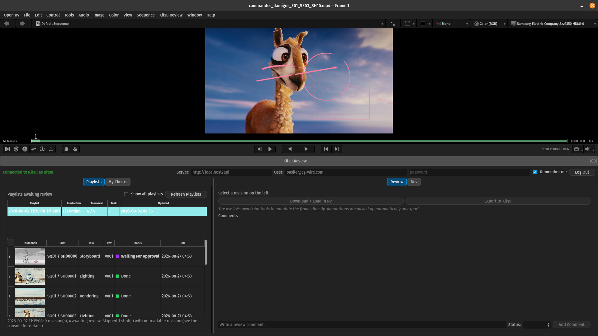
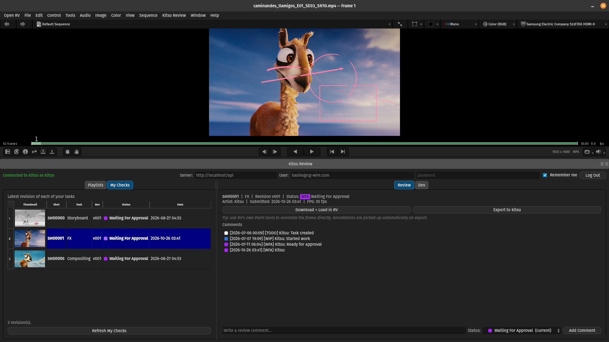

# OpenRV Kitsu integration



This OpenRV package integrates [CGWire's Kitsu](https://www.cg-wire.com/) in your workspace. It adds a **Kitsu Review** panel, docked below the RV viewport, for reviewing revisions, commenting and syncing annotations both ways.

## Features

### Login

- Log in with your Kitsu server URL, email and password.
- **Remember me** keeps you logged in between OpenRV sessions. The Kitsu session token is stored in your system's credential store (macOS Keychain, Windows Credential Manager, Secret Service / KWallet on Linux); your password is never saved. Log Out removes the saved session and revokes it on the server.
- Server URL and email are always remembered, even without `keyring`.
- Expired access tokens are refreshed automatically mid-session.

### Finding revisions to review



- **Playlists** tab: the playlists of your open productions, most recently updated first.
  - Only playlists with something awaiting review (a task in a feedback-request status such as WFA) are shown; tick **Show all playlists** to list the rest.
  - A "To review" count per playlist: estimated (`~`) until the playlist is opened, then exact.
  - Client playlists are marked `(client)`.
- **My Checks** tab: the latest revision of each of your tasks.
- Revisions are listed with a thumbnail, shot (`SEQ / SHOT` in playlists), task type, revision number, status and date. Revisions awaiting review are shown in bold, with the status's Kitsu color.

### Reviewing

- **Download + Load in RV** downloads the preview (movies and still images) to `~/kitsu_review_downloads`, adds it to the RV session and loads the annotations already stored on Kitsu onto it.
- Playback is set to the production's frame rate from Kitsu (24 fps when it isn't set), so RV frames line up with Kitsu's.
- Comment history for the task, each comment tagged with the status it was posted with.
- **Add Comment** posts a comment, optionally with a status change. The status dropdown only offers statuses your role and the production allow. A status change can be posted without any text, as in Kitsu.

### Annotations

Draw with RV's own Paint tools, then **Export to Kitsu**. Supported in both directions:

| OpenRV | Kitsu |
| --- | --- |
| Pen (with pressure) | Brush stroke |
| Ellipse | Circle / ellipse |
| Rectangle | Rectangle |
| Arrow | Arrow |
| Text (bold, italic, underline, multi-line) | Text |
| Eraser | Eraser |

- Export picks up strokes from every paint node drawing on the revision's source, including the sequence-level ones RV draws into in a sequence view.
- Unchanged annotations keep their original Kitsu id, author and timestamps; changed ones (e.g. erased in RV) are sent as updates, new ones as additions.
- Erasers are translated between RV's "erase what was drawn before" model and Kitsu's per-object eraser paths, so erased strokes look the same on both sides.

### Dev tab

A JSON view of the annotations under the playhead, for debugging the conversion:

- the raw OpenRV paint properties,
- the same converted to Kitsu format (what Export would send),
- what Kitsu currently stores for the selected revision.

It can auto-refresh every second and copy the JSON to the clipboard.

## Limitations

- RV ellipses, rectangles and text can't be rotated; rotation from Kitsu is dropped.
- Rounded rectangle corners and Kitsu's arrow head size aren't carried over to RV.
- Text is drawn in RV's default font, left-aligned and without Kitsu's background box.
- Kitsu's "restore" (inverted) eraser has no RV equivalent and is skipped. Kitsu text can't be erased.
- Lines from Kitsu aren't loaded into RV.

## Installation

1. Install the dependencies into OpenRV's Python: `pip install gazu requests keyring` (`keyring` is optional; without it, **Remember me** is disabled).
2. Download the latest package from the Github repository: [Releases](https://github.com/cgwire/openrv/releases)
3. Install the package in `OpenRV > Preferences > Packages > Add Packages`.
4. Open the panel from the `Kitsu Review > Toggle Review Panel` menu.

## Development

The plugin is split in three modules:

- `kitsu.py`: the panel UI and the RV mode that docks it.
- `kitsu_review_model.py`: Kitsu (gazu), session persistence, status rules and RV paint-node reading/writing.
- `annotation_converter.py`: pure-Python Kitsu ↔ OpenRV annotation conversion, with no OpenRV, Qt or gazu dependency.

1. Package the plugin for OpenRV:

```bash
zip -r kitsu-1.0.rvpkg ./src/PACKAGE ./src/kitsu.py ./src/kitsu_review_model.py ./src/annotation_converter.py
```

2. Install the package in `OpenRV > Preferences > Packages > Add Packages` or use the OpenRV CLI:

```sh
$OPENRV_PATH/_build/stage/app/bin/rvpkg -uninstall $HOME/.rv/Packages/kitsu-1.0.rvpkg -force
$OPENRV_PATH/_build/stage/app/bin/rvpkg -remove $HOME/.rv/Packages/kitsu-1.0.rvpkg -force
$OPENRV_PATH/_build/stage/app/bin/rvpkg -add $HOME/.rv/Packages PACKAGE_PATH/kitsu-1.0.rvpkg
$OPENRV_PATH/_build/stage/app/bin/rvpkg -install $HOME/.rv/Packages/kitsu-1.0.rvpkg
```

### Converting annotations outside OpenRV

`annotation_converter.py` runs standalone, which is handy for testing against a Kitsu annotation dump:

```sh
python src/annotation_converter.py annotations.json --width 1920 --height 1080 --fps 24 -o shapes.json
```

Run it with `--help` for all options (canvas size, frame offset, frame base, default frame for stills).

## Contributing

## TODO

- Load Kitsu lines into RV
- Carry rotation over for ellipses, rectangles and text